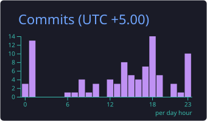
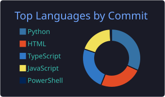
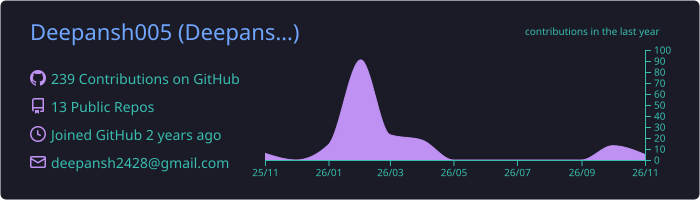

<!-- ===================== HEADER ===================== -->
<div align="center">


<a href="https://github.com/Deepansh005">
  
</a>

<br/>


</div>

<br/>

<!-- ===================== TERMINAL ===================== -->
## 🖥️ `~/whoami`

```js
const deepansh = {
  name:       "Deepansh Saxena",
  role:       "Full Stack Developer",
  focus:      ["MERN / Next.js", "Java + Spring Boot", "Data Structures & Algorithms"],
  currently:  "Grinding Striver's A2Z DSA Sheet & building full-stack projects",
  learning:   ["System Design", "Microservices", "Kafka & Event-driven systems"],
  funFact:    "I debug with console.log and call it engineering 😎",
  lookingFor: "Internships • Open-source • Collabs"
};
```

<br/>

<!-- ===================== TECH STACK ===================== -->
## ⚡ Tech Arsenal

<div align="center">

**🎨 Frontend**<br/>


**🧠 Backend**<br/>


**🗄️ Databases & Streams**<br/>


**🛠️ Tools**<br/>


</div>

<br/>

<!-- ===================== STATS ===================== -->
## 📊 Holographic Stats

<div align="center">


<br/>


</div>

<br/>

## 📈 Coding Activity

<div align="center">


</div>

<br/>

## 🐍 Contribution Snake

<div align="center">
<picture>
  <source media="(prefers-color-scheme: dark)" srcset="https://raw.githubusercontent.com/Deepansh005/Deepansh005/output/github-contribution-grid-snake-dark.svg">
  <source media="(prefers-color-scheme: light)" srcset="https://raw.githubusercontent.com/Deepansh005/Deepansh005/output/github-contribution-grid-snake.svg">
  
</picture>
</div>

<br/>

## 🏆 Profile Summary

<div align="center">

</div>

<br/>

<!-- ===================== CODING PROFILES ===================== -->
## 🧩 Competitive Arena

<div align="center">

<a href="https://leetcode.com/u/Deepansh_005/">
  
</a>

</div>

<br/>

<!-- ===================== PROJECTS ===================== -->
## 🚀 Featured Projects

<div align="center">

<a href="https://github.com/Deepansh005/regintel-ai"></a>
<a href="https://github.com/Deepansh005/echolearn-ai"></a>

</div>

<br/>

<!-- ===================== CONNECT ===================== -->
## 🔗 Initiate Handshake

<div align="center">

<a href="mailto:deepansh2428@gmail.com"></a>
<a href="https://www.linkedin.com/in/deepanshu005/"></a>
<a href="https://leetcode.com/u/Deepansh_005/"></a>
<a href="https://www.instagram.com/deepansh.005/"></a>

</div>

<br/>

<div align="center">

```text
┌──────────────────────────────────────────────┐
│  "First, solve the problem. Then, write the  │
│   code."                       — John Johnson │
└──────────────────────────────────────────────┘
```


</div>
